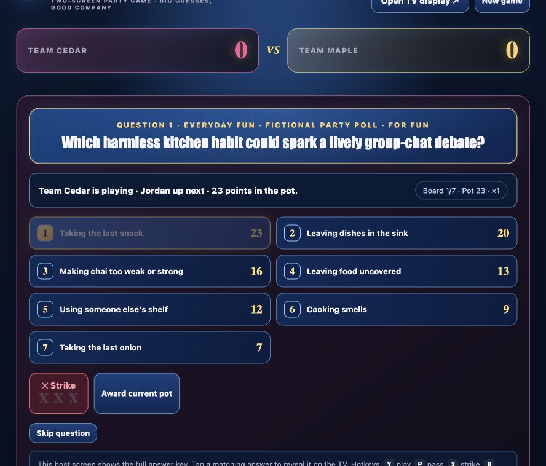
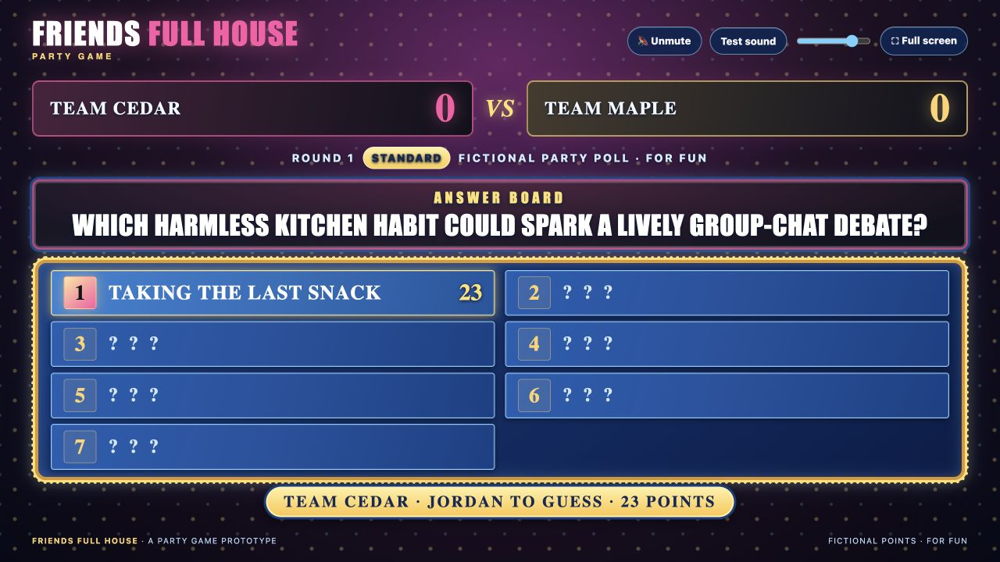

# Friends Full House

An independent two-screen party game prototype. One screen is for the host to set up teams and control the rounds; the other shows the shared answer board.

**Status:** working prototype. The GitHub Pages demo runs in local browser mode. Its host and audience pages sync across tabs in the same browser profile on the same device; cross-device play requires separately deploying the optional Worker and D1 backend documented below.

## Try it

- **[Open the public demo](https://tanupunjani.github.io/friends-full-house/)**
- **[Open Host Control](https://tanupunjani.github.io/friends-full-house/host.html)**
- **[Open Audience Display](https://tanupunjani.github.io/friends-full-house/tv.html)**
- **[Read the engineering case study](https://tanupunjani.github.io/friends-full-house-case-study/)**

Open the two game views in separate tabs in the same browser profile. Use fictional team and player names while exploring. The prototype has no sign-in or participant accounts.

## Implemented functionality

- Two-team setup with 4–8 participants per team and rotating players.
- Host-only answer key and a separate audience answer board.
- Standard, double, and triple rounds; scorekeeping; face-off, play/pass, strikes, and an eight-second steal.
- Skip a question without scoring it. Used questions stay out of the current game.
- Fast Money with two contestants, five unused prompts, timed answer entry, private responses until submission, and editable scores before reveal.
- Editable prompts, accepted-answer synonyms, and point values.
- Responsive host and audience layouts, keyboard shortcuts for host actions, labeled inputs, and reduced-motion CSS handling.
- Optional short synthesized tones in the audience view. Sound is user-initiated and can be muted.
- Fifteen original prompts. Their answer choices and point values are fictional examples, not survey findings.

## Run locally

The static prototype has no package dependencies. Python 3 and Node.js are only needed for local serving and tests.

```sh
python3 -m http.server 8000
```

Open `http://localhost:8000/host.html` and `http://localhost:8000/tv.html` in separate tabs in the same browser profile. The host and audience views communicate with `BroadcastChannel` and the browser `storage` event. The app stores the active game and edited question bank in that browser's local storage.

## Optional cross-device backend

The repository includes an optional Cloudflare Worker and D1 implementation. It creates six-character rooms, stores a hash of the host key, returns only revealed answers to the audience view, and expires rooms after 72 hours. The Worker tests use an in-memory D1-compatible test double; no live backend is deployed by this repository. Cross-device synchronization is therefore **not available on the public Pages demo**.

To build the Worker bundle for your own deployment:

```sh
python3 scripts/build_worker.py
python3 scripts/validate_worker.py
```

Copy `wrangler.toml.example` to `wrangler.toml`, create and bind your own D1 database, then deploy with the Cloudflare Wrangler CLI. `wrangler.toml` is intentionally ignored by Git. Do not commit account credentials, API tokens, or private configuration.

## Tests

```sh
python3 scripts/build_worker.py
python3 scripts/validate_worker.py
node --test tests/*.test.cjs tests/*.test.mjs
```

The tests cover round transitions, scoring, question skipping and non-reuse, buzzer state, Fast Money, room creation, host authorization, hidden unrevealed answers, and private static question-bank routing. They do not constitute browser end-to-end, load, security, or clinical testing.

## Architecture

See [the architecture notes](docs/architecture.md) for the browser state model, optional Worker API, synchronization tradeoffs, and limitations.

## Screenshots

These captures show the host answer key and the separate audience board using fictional data:





## Data, assets, and reuse

The public build contains no show logos, show recordings, scraped question sets, portraits, or personal photos. The prompt deck consists of original prompts with fictional answer points. Screenshots use synthetic team names. No external question dataset or third-party image is bundled.

This repository is published for review. No separate license is granted for reuse of the source code or original prompt content.
